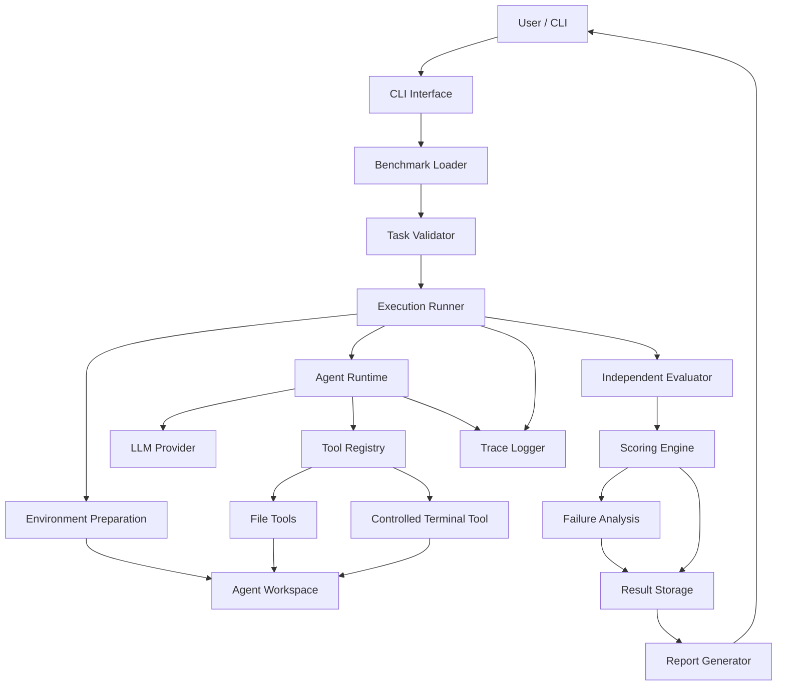
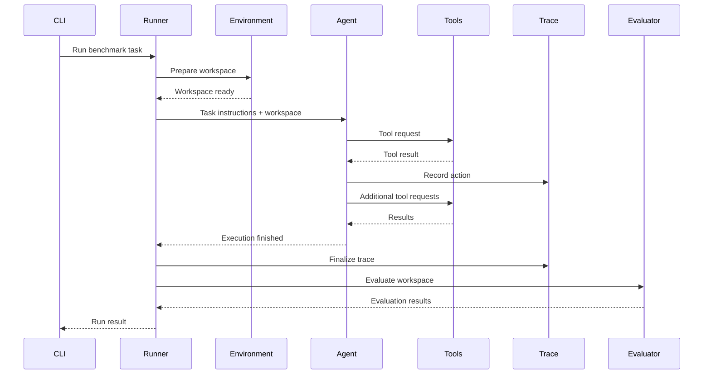

# AI Agent Bench - Architecture

**Version:** 0.1.0
**Status:** MVP Architecture
**Architecture Style:** Modular monolith / local-first

---

## 1. Architecture Overview

AI Agent Bench is designed as a lightweight, modular Python application.

The framework orchestrates the complete benchmark lifecycle:

**Task Loading → Validation → Environment Preparation → Agent Execution → Trace Collection → Independent Evaluation → Scoring → Failure Analysis → Reporting**

The MVP will run locally and use the filesystem for benchmark definitions, execution workspaces, traces, and results.

No Docker, Kubernetes, microservices, or dedicated database infrastructure is required.

---

## 2. Architectural Principles

### 2.1 Modular Design

Each major responsibility is implemented in a dedicated module with defined interfaces.

### 2.2 Local-First

The framework runs on the developer's local machine.

### 2.3 Independent Evaluation

The agent and evaluator are separate components.

The agent attempts to solve the benchmark task. The evaluator independently verifies the final workspace state.

### 2.4 Reproducibility

Each benchmark run receives a unique identifier and records relevant configuration and execution metadata.

### 2.5 Observable Execution

The framework records execution traces, tool interactions, errors, and outcomes.

### 2.6 Simplicity

The architecture avoids unnecessary infrastructure and complexity.

---

## 3. High-Level System Architecture



---

## 4. Core Components

### 4.1 CLI Interface

**Module:** `cli.py`

Responsible for exposing benchmark operations through command-line commands.

Planned operations:

- List tasks
- Validate tasks
- Run benchmark tasks
- Inspect results
- Generate reports

The CLI delegates business logic to internal modules.

---

### 4.2 Configuration

**Module:** `config.py`

Responsible for:

- Loading application configuration
- Loading environment variables
- Providing agent and execution settings
- Managing model configuration
- Providing execution limits
- Centralizing configuration defaults

Secrets must not be committed to Git.

---

### 4.3 Benchmark Loader

**Module:** `benchmark/loader.py`

Responsible for:

- Discovering benchmark tasks
- Loading YAML task definitions
- Resolving task directories
- Loading task metadata
- Preparing task definitions for validation and execution

---

### 4.4 Benchmark Validator

**Module:** `benchmark/validator.py`

Responsible for checking:

- Required task metadata
- Valid configuration structure
- Required task files
- Supported task types
- Evaluation configuration
- Environment configuration
- Task completeness

Invalid benchmark tasks must be rejected before execution.

---

### 4.5 Agent Interface

**Module:** `agent/interface.py`

Defines the abstraction through which an agent receives tasks and executes them.

The interface should allow future support for different agents without requiring changes to the benchmark execution or evaluation systems.

---

### 4.6 Agent Runtime

**Module:** `agent/runtime.py`

Responsible for:

- Constructing agent prompts
- Sending requests to the configured model
- Processing model responses
- Handling tool calls
- Maintaining execution state
- Applying stopping conditions
- Handling execution errors
- Enforcing iteration limits

The MVP will use a real LLM-backed agent.

---

### 4.7 Tool Registry

**Module:** `agent/tools.py`

Responsible for providing the tools available to the agent.

Initial tools:

- List files
- Read files
- Write files
- Modify files
- Execute permitted terminal commands

Tools must operate on the designated task workspace wherever practical.

Tool access should be explicit rather than unrestricted.

---

## 5. Execution Architecture

### 5.1 Execution Runner

**Module:** `execution/runner.py`

The execution runner orchestrates a benchmark run.

Responsibilities:

1. Receive a validated task.
2. Create a unique run identifier.
3. Prepare the task workspace.
4. Initialize execution configuration.
5. Start the agent.
6. Record execution information.
7. Handle timeouts and failures.
8. Finalize the run.
9. Invoke independent evaluation.
10. Store and report results.

---

### 5.2 Environment Preparation

**Module:** `execution/environment.py`

Responsible for:

- Creating the run workspace
- Copying starter files
- Preparing task-specific environments
- Ensuring the agent operates on the run-specific workspace
- Preparing evaluation inputs
- Cleaning up temporary resources when appropriate

Each run should use a separate workspace to avoid contamination between experiments.

---

### 5.3 Workspace Structure

Each execution should use an isolated working directory at the application level.

Conceptual example:

```text
results/
└── runs/
    └── RUN-20261125-001/
        ├── metadata.json
        ├── workspace/
        │   └── [task starter files]
        ├── trace.jsonl
        ├── evaluation.json
        └── result.json
```

The workspace separation reduces accidental cross-run contamination.

It does not provide operating-system-level security isolation.

---

### 5.4 Controlled Terminal Execution

The terminal tool must apply reasonable restrictions.

Possible controls:

- Command allowlisting where practical
- Working-directory restrictions
- Execution timeout
- Output-size limits
- Tool-call limits
- Environment-variable restrictions
- Error recording

Because the MVP does not use a dedicated sandbox, command execution remains a security risk.

The framework must clearly document this limitation.

---

## 6. Agent Execution Lifecycle



---

## 7. Execution Trace

**Module:** `execution/trace.py`

The trace logger records information about the benchmark run.

Potential trace information:

- Run identifier
- Task identifier
- Timestamp
- Agent action
- Tool name
- Tool input
- Tool output
- Tool execution duration
- Tool errors
- Agent messages
- Iteration number
- Execution status

Trace data should be stored in JSON Lines format where appropriate.

Example:

```json
{
  "run_id": "RUN-001",
  "task_id": "PB-SWE-001",
  "timestamp": "2026-11-25T12:00:00Z",
  "event": "tool_call",
  "tool": "read_file",
  "input": {
    "path": "src/example.py"
  },
  "status": "success"
}
```

Trace information should help reconstruct what happened during an agent run.

---

## 8. Evaluation Architecture

### 8.1 Independent Evaluator

**Module:** `evaluation/evaluator.py`

The evaluator is responsible for determining task success independently of the agent.

It must not rely solely on:

- Agent claims
- Agent-generated summaries
- Agent self-assessment
- Agent-reported completion status

The evaluator should use objective verification.

---

### 8.2 Evaluation Methods

Depending on the task, evaluation may include:

- Automated tests
- Assertions
- Required file checks
- File-state verification
- Output validation
- Task-specific verification scripts

---

### 8.3 Hidden Evaluation

Hidden tests must remain outside the agent-accessible workspace.

Conceptual separation:

```text
Task Package
├── task.yaml
├── starter/
├── visible_tests/
├── hidden_tests/
└── reference/
```

During execution:

```text
Agent
  |
  v
Run Workspace
├── starter files
└── visible tests, if provided

Hidden Evaluator
  |
  v
Protected Evaluation Resources
├── hidden tests
└── evaluation scripts
```

Hidden tests must not be copied into the agent workspace.

The evaluator should execute against the final workspace after the agent has finished.

---

## 9. Scoring Engine

**Module:** `evaluation/scoring.py`

The scoring engine converts independent evaluation outcomes into structured scores.

The initial scoring system should be simple and transparent.

Potential metrics:

- Overall task success
- Test pass rate
- Tests passed
- Tests failed
- Partial score where supported
- Completion status

The scoring methodology must be defined per task or through a clearly documented common scoring rule.

Scores must be derived from evaluation evidence.

---

## 10. Failure Analysis

**Module:** `evaluation/failure_analysis.py`

The failure analysis component categorizes unsuccessful benchmark runs.

Initial categories:

- Task misunderstanding
- Incorrect approach
- Incorrect implementation
- Incomplete execution
- Test failure
- Regression
- Tool misuse
- Tool failure
- Environment failure
- Timeout
- Execution limit reached
- Verification failure

Failure analysis should use available execution traces, tool errors, and evaluation outcomes.

Automated failure classification may be introduced later.

---

## 11. Results Storage

**Module:** `results/storage.py`

The MVP uses filesystem-based storage.

Potential artifacts:

```text
results/
├── runs/
│   └── RUN-ID/
│       ├── metadata.json
│       ├── trace.jsonl
│       ├── evaluation.json
│       └── result.json
└── reports/
    └── RUN-ID.md
```

The storage system should support:

- Saving run metadata
- Saving execution traces
- Saving evaluation results
- Saving scores
- Saving failure analysis
- Retrieving previous runs

---

## 12. Reporting

**Module:** `results/reporting.py`

Reports should summarize:

- Task information
- Agent configuration
- Run information
- Execution status
- Task score
- Evaluation results
- Duration
- Tool usage where available
- Failure classification
- Execution summary

The MVP will generate Markdown and structured JSON reports.

CSV export may be added if time permits.

---

## 13. Difficulty Analysis

**Module:** `analysis/difficulty.py`

The initial framework will support task difficulty metadata.

Possible difficulty levels:

- Easy
- Medium
- Hard

Difficulty will initially be assigned during task design.

Future research may investigate empirically estimated task difficulty using observed agent pass rates.

The MVP will not claim statistically validated difficulty estimates.

---

## 14. Testing Architecture

Testing will be organized into three levels.

### Unit Tests

**Directory:** `tests/unit/`

Test individual components, including:

- Configuration
- Task loading
- Task validation
- Scoring
- Storage
- Reporting
- Failure categorization

### Integration Tests

**Directory:** `tests/integration/`

Test interactions between components.

Examples:

- Task loader and validator
- Runner and environment
- Agent and tools
- Evaluator and scoring
- Storage and reporting

### End-to-End Tests

**Directory:** `tests/end_to_end/`

Test the complete benchmark lifecycle.

Example:

```text
Load Task
    ↓
Validate Task
    ↓
Prepare Workspace
    ↓
Execute Agent
    ↓
Collect Trace
    ↓
Evaluate Solution
    ↓
Calculate Score
    ↓
Store Result
    ↓
Generate Report
```

---

## 15. Technology Architecture

| Component            | Technology           |
| -------------------- | -------------------- |
| Programming language | Python               |
| CLI                  | Typer                |
| Task configuration   | YAML                 |
| Validation           | Pydantic             |
| Agent integration    | LLM API              |
| Testing              | Pytest               |
| Linting              | Ruff                 |
| Logging              | Python logging       |
| Results              | JSON / JSONL         |
| Reports              | Markdown             |
| Version control      | Git                  |
| Repository           | GitHub               |
| Development          | VS Code + PowerShell |

Technology choices may be adjusted if implementation constraints require it.

---

## 16. Security Considerations

The architecture is local-first but does not provide a fully secure execution sandbox.

Potential risks:

- Malicious task instructions
- Prompt injection
- Unsafe generated commands
- Unauthorized filesystem access
- Secret exposure
- Excessive resource usage
- Agent execution loops

Mitigation mechanisms will include:

- Workspace-oriented file tools
- Restricted terminal access where practical
- Timeouts
- Iteration limits
- Tool-call limits
- Output limits
- Separation of hidden evaluation resources
- Explicit security documentation

These controls reduce risk but do not guarantee isolation from malicious execution.

---

## 17. Future Architecture Evolution

Future versions may introduce:

- Multiple agent adapters
- Agent comparison
- Benchmark suites
- Additional task types
- More advanced trace analysis
- Automated failure clustering
- Empirical difficulty estimation
- Benchmark selection strategies
- Statistical analysis
- Rank-preservation experiments
- Scaffold comparison
- Temporal benchmark validation
- Optional external execution infrastructure

These capabilities are outside the initial MVP unless time and resources permit.

---

## 18. Architecture Summary

AI Agent Bench uses a modular local-first architecture designed around independent responsibilities.

The framework separates:

- Benchmark definition
- Task validation
- Environment preparation
- Agent execution
- Tool interaction
- Trace collection
- Independent evaluation
- Scoring
- Failure analysis
- Result storage
- Reporting

The central design principle is that **agent performance must be evaluated through observable execution and independent verification, not through self-reported success.**

---

**End of Architecture Document**
